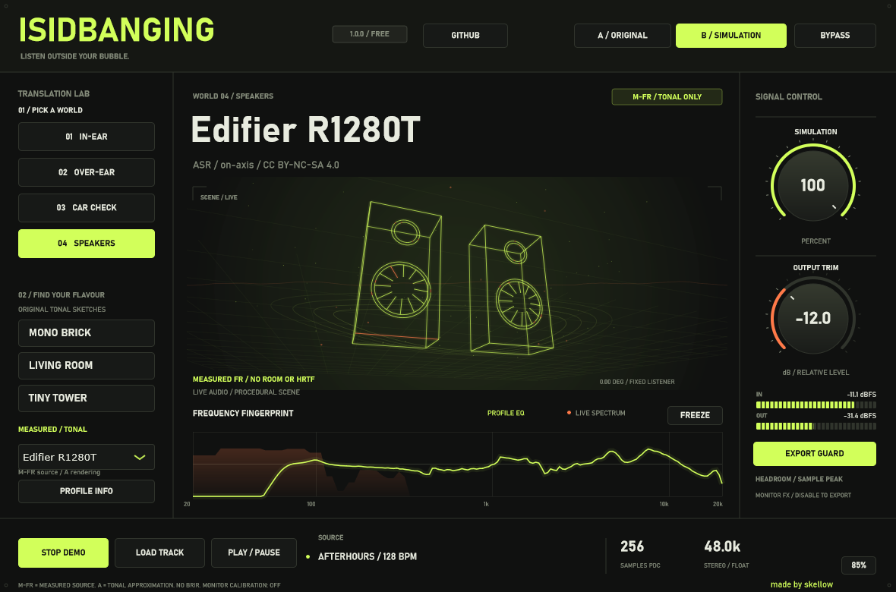

# IsIdBanging 1.0

**Listen outside your bubble.** Darmowy plugin do porównywania barwy miksu na różnych rodzajach odsłuchu. Natywne **VST3 i samodzielne EXE dla Windows x64**, stworzone przez **skellow**.

## Pobierz

Gotowe pliki są w [Releases](https://github.com/Reekksio/IsIdBanging/releases/latest). Pobierz `IsIdBanging-1.0.0-Windows-x64.zip` i rozpakuj cały katalog. Repozytorium zawiera dokumentację i wydania binarne; kod aplikacji nie jest obecnie publikowany.

## Uruchom EXE

Otwórz `IsIdBanging.exe`, kliknij **PLAY DEMO** albo **LOAD TRACK** i wybierz WAV, AIFF, FLAC lub MP3. Plik można też przeciągnąć na okno. Odtwarzacz zapętla utwór; limit wynosi 10 minut. W razie potrzeby wybierz urządzenie wyjściowe przez **Options → Audio/MIDI Settings**.

## Zainstaluj VST3

1. Zamknij instancje IsIdBanging w DAW.
2. Kliknij prawym przyciskiem **Install-VST3.cmd → Uruchom jako administrator**.
3. Instalator kopiuje kompletny pakiet do `C:\Program Files\Common Files\VST3\IsIdBanging.vst3` i sprawdza sumy SHA-256.

W FL Studio: **Options → Manage plugins → Verify plugins → Find installed plugins**. Następnie **Mikser → slot efektu → More plugins → IsIdBanging**. Zaznacz gwiazdkę, żeby dodać go do podręcznej listy. Przy aktualizacji włącz **Rescan previously verified plugins** i **Rescan plugins with errors**. To efekt odsłuchowy, nie instrument w Channel Rack.

FL Studio wymaga standardowej lokalizacji VST3. Samo dodanie folderu projektu w Plugin search paths nie wystarcza. [Instrukcja Image-Line](https://www.image-line.com/fl-studio-learning/fl-studio-online-manual/html/basics_externalplugins.htm#vstfolders).

## Odsłuch

- Cztery światy: **IN-EAR, OVER-EAR, CAR CHECK, SPEAKERS**.
- 12 oryginalnych profili syntetycznych, po trzy w każdej kategorii.
- Lista **MEASURED / TONAL** udostępnia zainstalowane profile oparte na liczbowych charakterystykach FR.
- Publiczna paczka zawiera trzy takie profile: **Edifier R1280T, IKEA SYMFONISK Picture Frame, Apple HomePod (ASR; generacja nieokreślona)**. Dane i ich opracowania są udostępnione osobno na CC BY-NC-SA 4.0.
- **A / ORIGINAL** i **B / SIMULATION** zachowują wspólny trim. **BYPASS** omija także trim. **SIMULATION** reguluje udział przetworzonego sygnału.
- Profil przechodzi w następny liniowo przez 100 ms. Nowo wybrany, nieaktywny FIR najpierw rozgrzewa historię przez około 0,69 s; w tym czasie słychać poprzedni profil i widać **PREPARING FIR**. Pozwala to ograniczyć CPU bez ucinania ogona. Trim i A/B są wygładzane przez 20 ms. Wszystkie ścieżki mają 256 próbek opóźnienia.
- Animowana scena 3D, oscyloskop, widmo FFT i mierniki sample peak reagują na audio. **FREEZE** zatrzymuje ruch sceny.
- **A**, **B**, **X**: porównanie i bypass. **← / →**: dostępne profile. **Spacja**: transport. Dwuklik gałki przywraca wartość domyślną. **85% / 100%**: rozmiar interfejsu.
- Przycisk **GITHUB** otwiera oficjalne repozytorium. W stopce znajduje się **made by skellow**.

## Co oznaczają profile pomiarowe

**M-FR** opisuje pochodzenie charakterystyki amplitudowej. Odsłuch jest **przybliżeniem barwy A**, z rekonstruowaną fazą minimalną. Nie deklarujemy fizycznej tożsamości z urządzeniem. Dane, metoda i odniesienie są opisane pod **PROFILE INFO**.

Filtry FIR korzystają z pełnych serii liczbowych, a nie zaokrąglonej tabeli PDF. Przygotowano osobne filtry dla **44,1 / 48 / 88,2 / 96 kHz**. Krzywe głośników opisują on-axis względem 1 kHz; nie dodajemy do nich wymyślonego pomieszczenia ani HRTF. Poza zmierzonym zakresem utrzymywana jest wartość brzegowa, jawnie traktowana jako ekstrapolacja. Nie odtwarzamy brakującej fazy pomiarowej, kanałów L/R, ANC, nieliniowej dynamiki ani SPL.

Program może odczytać prywatny bank użytkownika z `%APPDATA%\skellow\IsIdBanging\data`. Lokalna integracja dostarczonego arkusza obejmuje 25 krzywych: 22 mają odpowiednie odniesienie do odsłuchu, trzy pozostają nieaktywne z powodu braku potwierdzonej zgodności domeny. Surowe dane z B&K 5128, HMS II.3 i nieokreślonego stanowiska oratory1990 nie są mieszane. Profile 5128 porównywane są z odniesieniem DF 5128 i nadal mają status przybliżenia odsłuchu. Ten bank nie jest zawarty w publicznym release; uprawnienia do danych lokalnych pozostają przy ich źródłach.

Nie ma pozyskanych pomiarów konkretnych samochodów. **CAR CHECK** zawiera wyłącznie jawnie syntetyczne scenariusze. Brak danych oznacza brak danych; nie zastępujemy go zerową krzywą ani nazwą nowszego urządzenia.

## Monitorowanie i eksport

Wstaw plugin na tor odsłuchowy. **Wyłącz go przed eksportem mastera.** Export Guard pomija efekt tylko wtedy, gdy DAW zgłasza render offline; nie obejmuje każdego eksportu w czasie rzeczywistym. Pełny bypass pomija trim i może zwiększyć poziom. Mierniki pokazują sample peak, nie true peak; przy clip zmniejsz trim. Brak ukrytego limitera.

Korekcja własnych słuchawek, skalibrowane SPL, automatyczny gain match BS.1770 i pomiarowe BRIR nie są częścią 1.0. Odtwarzacz plików stosuje liniową interpolację przy zmianie Fs; do krytycznej pracy używaj wejścia z DAW. Nieobsługiwane Fs i brak wymaganych danych powodują czysty bypass z zachowaniem opóźnienia. Binaria nie są podpisane cyfrowo.

## Technologie

| Warstwa | Język / biblioteka |
| --- | --- |
| Wtyczka, DSP, interfejs | **C++20**, **JUCE 8.0.12** |
| Format pluginu | **Steinberg VST3 SDK 3.8.0**, dołączony do przypiętego JUCE |
| Filtry pomiarowe | FIR o fazie minimalnej; partycjonowany splot `juce::dsp::Convolution` |
| Profile oryginalne | Kaskady IIR, routing stereo/mono i modelowane opóźnione odbicia |
| Analiza i integralność | FFT, **SHA-256** z modułów JUCE |
| Przygotowanie danych lokalnie | **Python 3**, **NumPy**, odczyt XML/XLSX bez modyfikowania arkusza |
| Budowanie Windows | **CMake**, **MSVC / Visual Studio Build Tools**, Windows SDK |
| Instalator | **PowerShell** i **Windows CMD** |
| Walidacja | CTest, testy C++, **pluginval** |

JUCE jest używane w ramach warunków JUCE 8 Starter dla kwalifikującego się bezpłatnego projektu. [EULA JUCE 8](https://juce.com/legal/juce-8-licence/). Zależności i ich teksty licencji znajdują się w `licenses` oraz [NOTICE.md](NOTICE.md).

## Licencja i prawa

**Darmowe używanie, bezpłatne udostępnianie, zakaz sprzedaży aplikacji.** skellow zachowuje prawa do oryginalnego kodu, interfejsu, marki i autorskich profili. Możesz używać programu do tworzenia i publikowania własnej muzyki, również zawodowo. Szczegóły: [LICENSE.txt](LICENSE.txt).

Biblioteki i dane osób trzecich zachowują własne licencje. Pomiary ASR i pochodne pliki FIR są na **CC BY-NC-SA 4.0**; szczegóły i atrybucja są w `data/ATTRIBUTION.md`. Licencja aplikacji nie odbiera praw wynikających z tych licencji. Repozytorium nie jest obecnie wydaniem open source; ewentualne opublikowanie kodu nastąpi osobno.

**made by skellow** · [GitHub](https://github.com/Reekksio/IsIdBanging)
