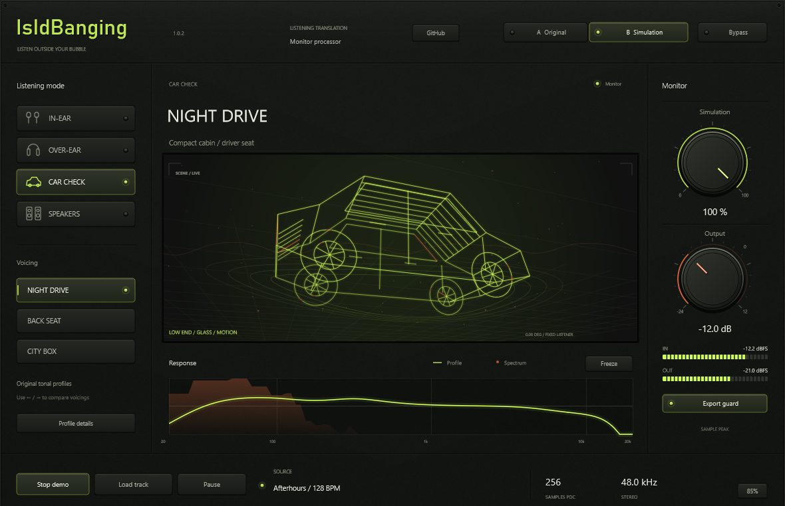
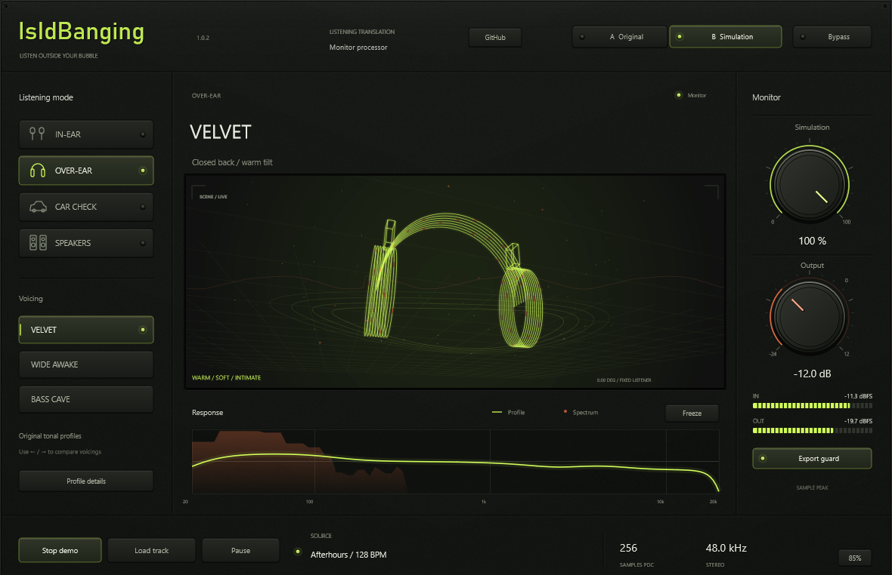
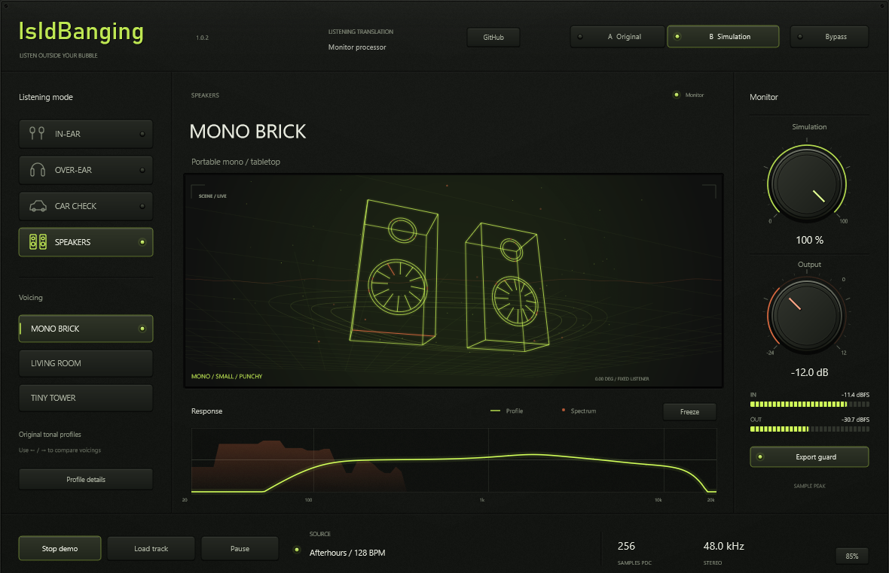

# IsIdBanging

**Listen outside your bubble.**

Check your mix through in-ear, over-ear, car and speaker-style voicings without leaving your session. IsIdBanging is a free **VST3 plugin and standalone Windows app** with twelve original tonal profiles, quick A/B comparison and audio-reactive 3D visuals.

Switch perspectives to check bass weight, vocal presence and top-end balance, then return to your original mix with a click.

**[Download for Windows](https://github.com/Reekksio/IsIdBanging/releases/latest)** · Windows x64 · VST3 + standalone EXE

## Twelve ways to check a mix

Choose one of four listening modes, then try its three original voicings.

| Listening mode | What to listen for | Voicings |
| --- | --- | --- |
| **IN-EAR** | Bass weight, a lighter low end and everyday listening balance | Sub Club · Air Gap · Pocket Hype |
| **OVER-EAR** | Warmth, forward mids and bass-heavy headphone balances | Velvet · Wide Awake · Bass Cave |
| **CAR CHECK** | Low-end build-up, cabin colour and midrange presence | Night Drive · Back Seat · City Box |
| **SPEAKERS** | Small-speaker focus, mono balance and a wider room perspective | Mono Brick · Living Room · Tiny Tower |

  
  

## Stay focused on the music

- **Compare in a click.** Switch between Original and Simulation while keeping the same output trim.
- **Set the amount.** Blend the voicing with your original signal and adjust the listening level with Output.
- **See the signal.** A wireframe 3D scene, waveform, live spectrum and level meters respond to your audio.
- **Try your own track.** Drop in a WAV, AIFF, FLAC or MP3, or press Demo to explore the controls straight away.

## Start listening

Download the Windows ZIP from [Releases](https://github.com/Reekksio/IsIdBanging/releases/latest) and extract the entire folder.

**Standalone:** open `IsIdBanging.exe`. Choose **Load track**, drop an audio file onto the window, or press **Demo**. Use **Play / Pause** to control playback.

**In your DAW:** run `Install-VST3.cmd` as administrator, scan for plugins and add IsIdBanging to your monitoring path. The installer places the complete VST3 bundle in the standard Windows VST3 folder.

**FL Studio:** open **Options → Manage plugins**, enable **Verify plugins** and select **Find installed plugins**. Then open a **Mixer effect slot → More plugins → IsIdBanging**.

Choose a listening mode and a voicing, then use **A Original / B Simulation** to compare. **Use IsIdBanging for monitoring and disable it before exporting your master.**

## Free to use

Use IsIdBanging for personal or professional music work. You can use and share the application for free; selling it is not permitted. See the [licence](LICENSE.txt) and [third-party notices](NOTICE.md).

Technology

Built with **C++20**, **JUCE 8** and the **Steinberg VST3 SDK**. Supporting tools use **Python / NumPy**, **CMake / MSVC** and **PowerShell**.

